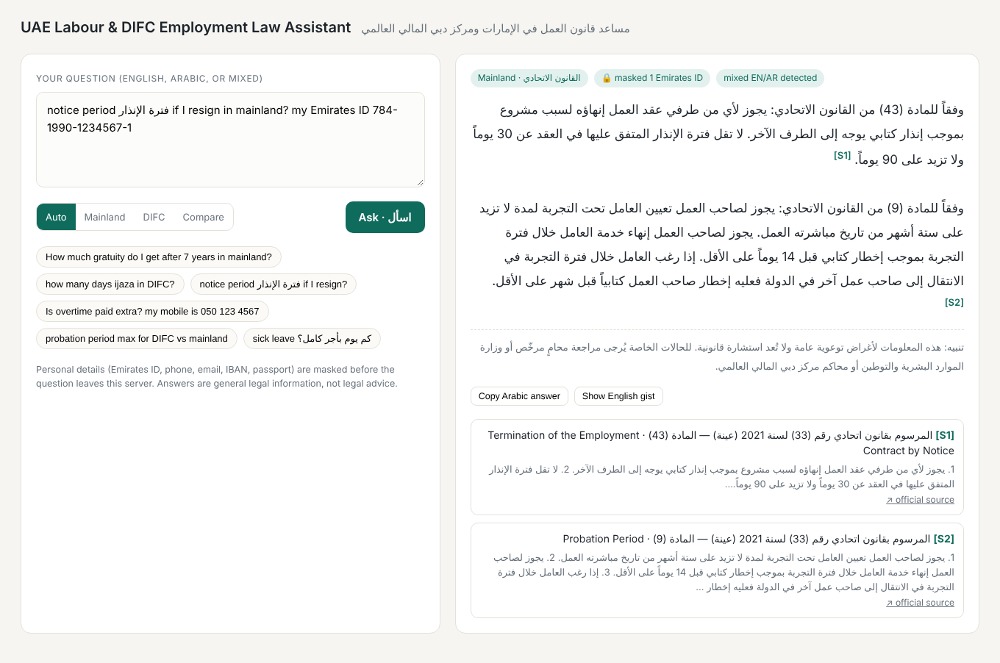
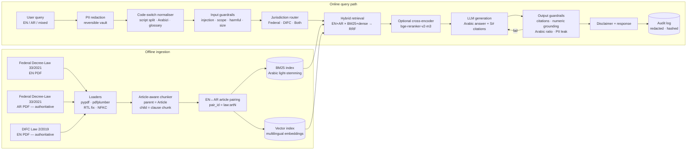
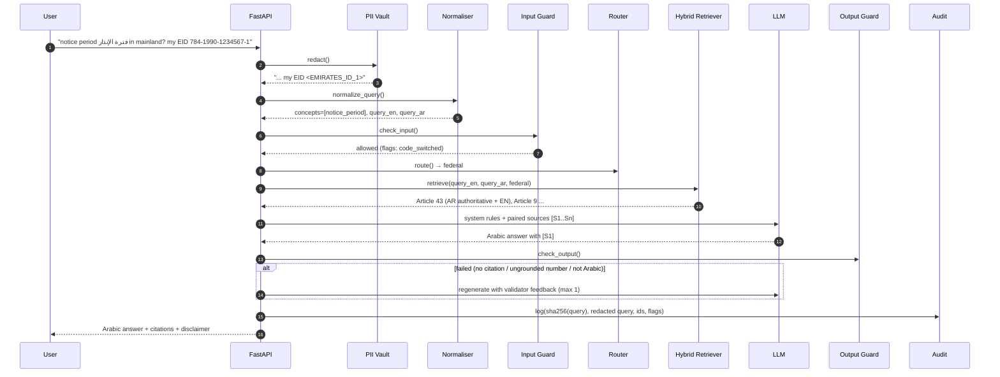

# UAE Labour Law & DIFC Employment Law — Bilingual RAG (EN ➜ AR)

An internal-knowledge **Retrieval-Augmented Generation** pipeline over the two employment regimes in the UAE:

| Regime | Source | Official language |
|---|---|---|
| **Onshore / Mainland** | Federal Decree-Law No. (33) of 2021 Regarding the Regulation of Employment Relationships, as amended (14/2022, 20/2023, 9/2024) + Cabinet Resolution No. (1) of 2022 | **Arabic prevails** |
| **DIFC** | DIFC Employment Law, DIFC Law No. 2 of 2019 (Consolidated Version No. 5, July 2025) | English only |

Users ask in **English** (or mixed English/Arabic/Arabizi). The system answers in **Modern Standard Arabic** with **article-level citations**, behind **input/output guardrails** and a **PII-protection layer**.



---

## Table of contents
1. [Architecture](#1-architecture)
2. [Request flow](#2-request-flow)
3. [Key design decisions](#3-key-design-decisions)
4. [Bilingual code-switching](#4-bilingual-code-switching)
5. [Guardrails](#5-guardrails)
6. [Data privacy](#6-data-privacy)
7. [Quick start](#7-quick-start)
8. [Using the official laws](#8-using-the-official-laws)
9. [Switching to OpenAI / Azure OpenAI](#9-switching-to-openai--azure-openai)
10. [API](#10-api)
11. [Evaluation](#11-evaluation)
12. [Project structure](#12-project-structure)
13. [Production roadmap](#13-production-roadmap)
14. [Disclaimer](#14-disclaimer)

---

## 1. Architecture



| Layer | Module | Default (offline) | Production option |
|---|---|---|---|
| Loading | `ingest/loaders.py` | pypdf / pdfplumber | Azure Document Intelligence (`ar` OCR) for scanned PDFs |
| Chunking | `ingest/chunker.py` | Article parents + clause children | same |
| Lexical index | `index/bm25.py` | built-in BM25 with Arabic stemming | OpenSearch with `arabic` analyzer |
| Dense index | `index/store.py` | NumPy cosine | Qdrant / pgvector / Azure AI Search |
| Embeddings | `index/embeddings.py` | char-n-gram hashing | `text-embedding-3-large` · `bge-m3` |
| Reranker | `retrieval/hybrid.py` | RRF only | `BAAI/bge-reranker-v2-m3` |
| LLM | `generation/llm.py` | `MockLLM` (extractive) | GPT-4o / Azure OpenAI (UAE North) |
| Guardrails | `guardrails/*` | deterministic rules | + LLM classifier / Azure AI Content Safety |
| Privacy | `privacy/*` | UAE regex PII + vault | + Presidio with Arabic NER |
| UI / API | `api/` | FastAPI + single-page RTL UI | behind API gateway + SSO |

---

## 2. Request flow



---

## 3. Key design decisions

1. **Answer from the official Arabic text, don't translate it.** For federal law the Arabic version legally prevails. Each English article is *paired* with its Arabic counterpart (`pair_id = fdl-33-2021:art51`), and both go into the prompt. The model reuses the official Arabic wording instead of translating English → Arabic, which removes the main source of legal mistranslation. DIFC law has no official Arabic, so the answer is translated and labelled *(ترجمة غير رسمية)*.
2. **Route by jurisdiction before you retrieve.** Mainland and DIFC rules differ (for example, gratuity under Article 51 vs. the DEWS / Qualifying Scheme under DIFC Article 66). An explicit, auditable router sends the query to `federal`, `difc` or `both`. When it can't tell, it uses `both` and the answer compares the two regimes. ADGM is detected and declined because it isn't in the knowledge base.
3. **Article-level parents, clause-level children.** Small chunks give better recall, and whole articles give correct citations. Table-of-contents duplicates are dropped by keeping the longest body for each article number.
4. **Four-way hybrid retrieval with RRF.** `{query_en, query_ar} × {BM25, dense}` are fused with Reciprocal Rank Fusion, so no score calibration is needed. Evidence from the EN and AR versions of the same article adds up.
5. **Guardrails are deterministic first.** Regex and rule checks are cheap, explainable and unit-tested. LLM-based checks are an optional extra layer, not the foundation.
6. **Runs fully offline by default.** The `mock` LLM plus `hashing` embeddings run the whole system in CI and on a laptop without keys. Production providers are a config change.

---

## 4. Bilingual code-switching

Real queries in the UAE mix scripts:

| Query | What happens |
|---|---|
| `how many days مكافأة نهاية الخدمة after 3 years?` | Arabic span → concept `end_of_service_gratuity`. EN query gets “gratuity” and AR query gets “مكافأة نهاية الخدمة” |
| `how many days ijaza in DIFC?` | Arabizi `ijaza` → `annual_leave`. Removed from the EN query and added as “الإجازة السنوية” to the AR query |
| `notice ٣٠ يوم?` | Arabic-Indic digits → `30` |
| `fatrat al tajruba max for mainland?` | Arabizi phrase → `probation`. The glossary match alone also passes the scope check |
| `الإجازة` vs `الاجازة`, `مكافأة` vs `مكافاة` | search normalisation folds hamza / alef / ta-marbuta / diacritics |

Pipeline (`text/codeswitch.py`):

1. **Segment** tokens into `latin | arabic | numeric` spans.
2. **Normalise**: digits to Western, strip tatweel, diacritics and RLM/LRM marks, fold letter variants (search copy only).
3. **Link concepts** with the bilingual glossary (`config/glossary.yaml`). It holds EN, AR and Arabizi surface forms and matches the longest form first.
4. **Expand** to a clean `query_en` and a clean `query_ar`. BM25 runs each query against its own language. Dense search goes cross-lingual when the embedder is multilingual.
5. **Answer terminology**: the prompt tells the model to use the preferred Arabic term and add the user's English term once in parentheses, e.g. *مكافأة نهاية الخدمة (End of Service Gratuity)*. Bilingual users can follow the answer this way.

Extending it means adding a concept or Arabizi spelling to `glossary.yaml`, with no code change.

---

## 5. Guardrails

### Input (`guardrails/input_guard.py`)

| Check | Detects | Action |
|---|---|---|
| Size | queries longer than `max_query_chars` | block |
| Prompt injection | “ignore previous instructions”, “reveal system prompt”, `<system>`, Arabic forms like “تجاهل التعليمات” | block (Arabic refusal) |
| Harmful intent | forging documents, bypassing WPS, avoiding gratuity | block |
| Other jurisdictions | “labour law in Saudi Arabia”, but not “I'm from India, gratuity in Dubai?” | block |
| ADGM | not in the knowledge base | polite decline |
| Scope | no employment topic and no glossary concept | block |
| High stakes | suing, absconding, travel ban, police | allow, plus an extra “seek legal advice” note |
| Indirect injection | instruction-like text inside retrieved documents | neutralised (`sanitize_context`) |

### Output (`guardrails/output_guard.py`)

| Check | Rule | On failure |
|---|---|---|
| Citations present | at least one valid `[S#]` | regenerate, then the “not enough information” fallback |
| Citations valid | `[S#]` must exist in the sources | strip invalid refs |
| **Numeric grounding** | every number in the answer (days, %, years) must appear in the sources or the question | regenerate, then a warning flag |
| Arabic ratio | at least 60% Arabic letters | regenerate, then a warning flag |
| PII leak | the answer must contain no raw Emirates ID, phone, email, IBAN or card | re-redact |
| Invented placeholders | `<PERSON_9>` that was never in the vault | strip |
| Disclaimer | always appended (Arabic) | — |

Regeneration sends the validator's findings back to the model (`max_regenerations: 1`).

---

## 6. Data privacy

Legal questions often carry personal data: *“My Emirates ID is 784-…, salary 12,000, my manager Ahmed…”*. None of it is needed to explain the law.

- **Redact before anything leaves the process.** `privacy/pii.py` detects UAE-specific identifiers and replaces them with typed placeholders. This happens before the guardrails, the LLM and the audit log:

  | Type | Example | Placeholder |
  |---|---|---|
  | Emirates ID | `784-1990-1234567-1`, also in Arabic-Indic digits | `<EMIRATES_ID_1>` |
  | UAE phone | `+971 50 123 4567`, `050-1234567` | `<PHONE_1>` |
  | Email | `a.b@x.ae` | `<EMAIL_1>` |
  | IBAN | `AE07 0331 2345 6789 0123 456` | `<IBAN_1>` |
  | Card | Luhn-validated 13–19 digits | `<CARD_1>` |
  | Passport | `passport N1234567` | `<PASSPORT_1>` |
  | Name | “my name is …” / “اسمي …” | `<PERSON_1>` |

  Salaries, years and day counts are not redacted on purpose, because the answer needs them for calculations.
- **Reversible vault, memory only.** The placeholder→value map lives for one request and is never written anywhere. Re-hydrating the answer for the user is optional (`privacy.rehydrate_user_pii_in_answer`).
- **Data minimisation in audit logs.** The log stores the SHA-256 of the raw query, the redacted query, routing, article ids, flags and latency. It never stores raw text. `AuditLogger.purge_older_than(days)` enforces retention (`privacy.audit_retention_days`).
- **No caching of answers** (`Cache-Control: no-store`), security headers and per-IP rate limiting are on by default.
- **Data residency.** Run with **Azure OpenAI in the UAE North region**, or with self-hosted models (bge-m3 + an open-weights LLM), so prompts stay in the UAE. This aligns with **UAE PDPL (Federal Decree-Law No. 45 of 2021)** and the **DIFC Data Protection Law No. 5 of 2020**. Confirm the obligations that apply with your DPO.
- **Production upgrade:** add Microsoft Presidio with an Arabic NER model (e.g. CAMeLBERT-NER) for names and addresses in free text (`requirements-optional.txt`).

---

## 7. Quick start

### Option A — local Python (offline, about 1 minute)

```bash
git clone https://github.com/ravimshetty/uae-labour-law-rag.git
cd uae-labour-law-rag
python -m venv .venv
# Windows: .venv\Scripts\activate      macOS/Linux: source .venv/bin/activate
pip install -r requirements-dev.txt

python scripts/ingest.py --sources data/sample/sources.yaml   # build index from the sample corpus
python scripts/ask.py "How much gratuity do I get after 7 years in mainland?" --debug
uvicorn uae_labour_rag.api.app:app --app-dir src --reload --port 8000
# open http://localhost:8000
```

> On Windows, if Smart App Control blocks `pytest.exe`/`uvicorn.exe`, use `python -m pytest` and `python -m uvicorn ...`, or use Docker (Option B).

### Option B — Docker

```bash
cp .env.example .env          # Windows: copy .env.example .env
docker compose up --build
# open http://localhost:8000
```

### Run tests and evals

```bash
python -m pytest -q
python scripts/eval.py
```

> `data/sample/` holds **synthetic, paraphrased** extracts so the system runs out of the box. They are **not** the official legal text. Use section 8 for real use.

---

## 8. Using the official laws

1. Download the official PDFs into `data/raw/` (URLs in `data/sources.yaml`):
   ```bash
   python scripts/download_sources.py
   ```
   Government portals sometimes block scripted downloads. If a download fails, open the printed URL in a browser and save the PDF to the path shown.
   - Federal Decree-Law 33/2021 (EN, consolidated with amendments): MOHRE / u.ae
   - Federal Decree-Law 33/2021 (AR, authoritative): uaelegislation.gov.ae
   - DIFC Employment Law (Consolidated Version No. 5, July 2025): difc.com
   - *(optional)* Cabinet Resolution 1/2022 (Executive Regulation)
2. Build the index:
   ```bash
   python scripts/ingest.py            # uses data/sources.yaml
   ```
3. Check the article counts in the log. Federal law has 74 articles. If extraction is off, adjust `article_pattern`, `stop_pattern` or `skip_until_pattern` for that document in `data/sources.yaml`. Arabic PDFs extracted in visual (reversed) order are fixed automatically in `loaders.py`.
4. Re-run `python scripts/eval.py`. The golden set uses the real article numbers.

Laws change, so check for new consolidated versions and re-ingest them.

---

## 9. Switching to OpenAI / Azure OpenAI

Set these in `.env` (or as environment variables):

```bash
# OpenAI
RAG_LLM__PROVIDER=openai
RAG_LLM__MODEL=gpt-4o
RAG_EMBEDDINGS__PROVIDER=openai
RAG_EMBEDDINGS__MODEL=text-embedding-3-large
OPENAI_API_KEY=sk-...

# or Azure OpenAI (UAE North for data residency)
RAG_LLM__PROVIDER=azure_openai
RAG_LLM__MODEL=<chat-deployment-name>
RAG_EMBEDDINGS__PROVIDER=azure_openai
RAG_EMBEDDINGS__MODEL=<embedding-deployment-name>
AZURE_OPENAI_ENDPOINT=...
AZURE_OPENAI_API_KEY=...
```

**Re-run `scripts/ingest.py` after changing the embedding provider**, because vectors from different models aren't compatible. Other knobs are in `config/settings.yaml`: `final_k`, `use_reranker`, `min_arabic_ratio`, `digits: arabic_indic`, and more.

---

## 10. API

`POST /api/ask`

```json
{ "query": "how many days ijaza in DIFC?", "jurisdiction": null, "debug": false }
```

Response (abridged):

```json
{
  "request_id": "3f9c1e2a7b10",
  "answer_ar": "يستحق الموظف الذي أمضى 90 يوماً على الأقل ... [S1]\n\nتنبيه: ...",
  "english_gist": "DIFC employees get at least 20 working days of paid vacation leave.",
  "jurisdiction": "difc",
  "citations": [{ "ref": "S1", "law_name_ar": "...", "article": "27", "title": "Vacation Leave", "snippet": "...", "source_url": "..." }],
  "flags": [{ "name": "code_switched_query", "severity": "info", "detail": "ijaza" }],
  "blocked": false,
  "redactions": {}
}
```

`GET /api/health` reports index size and active model. Interactive docs are at `/docs`.

---

## 11. Evaluation

`evals/golden.yaml` has 21 cases: English, Arabic, code-switched, Arabizi, comparison and adversarial guardrail cases. `scripts/eval.py` reports:

| Metric | Sample corpus, offline mode |
|---|---|
| Recall@6 | 1.00 |
| MRR | 0.97 |
| Routing accuracy | 1.00 |
| Citation rate | 1.00 |
| Mean Arabic ratio of answers | 0.996 |
| Guardrail accuracy | 1.00 |

These numbers come from the small synthetic corpus, so treat them as a regression baseline, not as a quality claim. Re-run against the official PDFs and your production models. For answer quality, add LLM-as-judge faithfulness and Arabic fluency scoring (e.g. RAGAS) to the same harness.

---

## 12. Project structure

```
uae-labour-law-rag/
├── config/
│   ├── settings.yaml          # all runtime knobs (env-overridable)
│   └── glossary.yaml          # EN / AR / Arabizi legal glossary
├── data/
│   ├── sources.yaml           # official documents + parsing patterns
│   ├── sample/                # synthetic demo corpus (NOT official text)
│   ├── raw/                   # official PDFs (git-ignored)
│   └── index/                 # built index (git-ignored)
├── src/uae_labour_rag/
│   ├── text/                  # arabic.py (normalisation) · codeswitch.py
│   ├── ingest/                # loaders · article chunker · build
│   ├── index/                 # bm25 · embeddings · store
│   ├── retrieval/             # router · hybrid (RRF, pairing, reranker)
│   ├── guardrails/            # input_guard · output_guard
│   ├── privacy/               # pii (vault) · audit
│   ├── generation/            # prompts · llm providers
│   ├── pipeline.py            # orchestration
│   └── api/                   # FastAPI app + static RTL UI
├── scripts/                   # ingest · ask · eval · download_sources
├── evals/golden.yaml
├── tests/                     # 29 unit + end-to-end tests
├── Dockerfile · docker-compose.yml · .github/workflows/ci.yml
└── docs/img/                  # screenshots
```

---

## 13. Production roadmap

- [ ] Executive Regulation (Cabinet Resolution 1/2022) and MOHRE ministerial resolutions as extra sources, with *law → regulation* cross-links
- [ ] Amendment-aware versioning (`effective_from` / `effective_to` per article) so users can ask “as of 2023”
- [ ] Streaming responses (SSE) in the UI
- [ ] SSO (Entra ID) + role-based access, and tenant-scoped audit
- [ ] OpenTelemetry / Langfuse tracing on redacted payloads
- [ ] Gratuity / leave calculator tool the LLM can call (deterministic maths, not generated maths)
- [ ] Human feedback loop (thumbs up/down → eval set)

---

## 14. Disclaimer

This project gives **general legal information, not legal advice**. The federal law's Arabic text is the authoritative version. Always check against the official sources and consult a licensed UAE lawyer, MOHRE or the DIFC Courts for a specific case.

---

**Author:** Ravindher Madishetty — Technical Architect, Enterprise AI · MIT License
